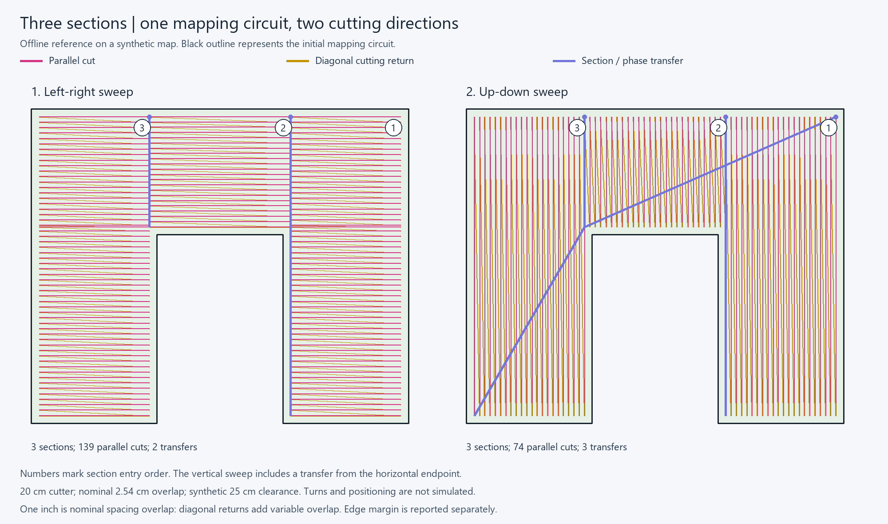

# Redkey mower firmware: original image, navigation research and custom development

This repository preserves the original Redkey ESP32-S3 application provenance, vendor download link, checksum and technical findings from inspecting the R HOME Android application and mower navigation code. It also contains an executable offline mowing planner and a simple Wi-Fi firmware uploader.

**Original firmware:** embedded `v0.3.5.6`, API release label `0.3.5`. **Custom firmware:** `0.3.6.0` is planned development; there is no compiled custom firmware binary yet. The Python planner is not flashable firmware. The uploader does not build, patch or relabel images.

| Start here | Contents |
|---|---|
| [Original vendor download](https://ldrobotota.s3.amazonaws.com/0.3.5.6.release.bin) | Upstream 1,972,000-byte application; binary is not included in this repository |
| [Original metadata](firmware/original/metadata.json) | Segments, descriptor, header, integrity checks |
| [Custom release status](firmware/custom/README.md) | Exact development/firmware-build boundary |
| [Planner source](src/planner/planner.py) / [rules](src/planner/rules.json) | General section coverage and parallel/diagonal rules |
| [Uploader](src/uploader/app.py) / [UI](src/uploader/index.html) | Local Wi-Fi update interface and authenticated transport |
| [Evidence index](docs/EVIDENCE_INDEX.md) | Searchable static evidence with source identities |
| [Privacy and provenance](docs/PRIVACY.md) | What is included, excluded and verified |
| [Artifact manifest](MANIFEST.sha256) | SHA-256 for every published content file |

Original image SHA-256:

```text
370b8e6d29a77764cf685498fc9e855f93ac992e5ebf5ae17292e666c6b67bae
```

No account data, real device serials, private network configuration, lawn maps, recorded routes, screenshots, tokens, signed download URLs or personal filesystem paths are distributed. All route examples are synthetic. Relative vendor source paths, firmware addresses, generic protocol fields, artifact hashes and a vendor-embedded development URL are technical artifact facts, not owner-specific configuration.

The original image is an application download, not a full flash/NVS dump. Container checks establish byte integrity; they do not independently authenticate the manufacturer or establish that a custom image will be accepted by a device. No physical installation or mowing acceptance is claimed.

The root license is retained. Vendor artifacts and dependencies remain third-party materials; see [THIRD_PARTY_NOTICES.md](THIRD_PARTY_NOTICES.md).

The vendor image contains an embedded TLS private key. **The binary is deliberately omitted from GitHub; only its vendor link, checksum and metadata are published.** It is also present in the byte-identical unauthenticated vendor download, not added by an owner account. See [the embedded-credential findings](#embedded-tls-credential-material-discovered-during-publication-review); this repository does not describe that vendor image as credential-free.

## Contents

- [Embedded TLS credential findings](#embedded-tls-credential-material-discovered-during-publication-review)
- [Original firmware: technical research dossier](#original-firmware-technical-research-dossier)
  - [How to read the evidence](#how-to-read-the-evidence)
  - [1. Artifact identity and version layers](#1-artifact-identity-and-version-layers)
  - [2. Application container and mapped segments](#2-application-container-and-mapped-segments)
  - [3. What the ESP32-S3 appears to own](#3-what-the-esp32-s3-appears-to-own)
  - [4. Firmware navigation is rule-driven, not a prewritten lawn route](#4-firmware-navigation-is-rule-driven-not-a-prewritten-lawn-route)
  - [5. Startup boundary-map state machine](#5-startup-boundary-map-state-machine)
  - [6. Starting-position and first-target rule](#6-starting-position-and-first-target-rule)
  - [7. Cutting axes and initial lane state](#7-cutting-axes-and-initial-lane-state)
  - [8. The nonadjacent lane-order rule](#8-the-nonadjacent-lane-order-rule)
  - [9. Area states and narrow passages](#9-area-states-and-narrow-passages)
  - [10. Boundary length is a runtime quantity](#10-boundary-length-is-a-runtime-quantity)
  - [11. Turn, localization and recovery leads that remain unresolved](#11-turn-localization-and-recovery-leads-that-remain-unresolved)
  - [12. Firmware-side OTA observations](#12-firmware-side-ota-observations)
  - [13. Why this is not a reproducible vendor firmware build yet](#13-why-this-is-not-a-reproducible-vendor-firmware-build-yet)
  - [14. Development direction for custom version 0.3.6.0](#14-development-direction-for-custom-version-0360)
  - [15. What is established, partial and open](#15-what-is-established-partial-and-open)
  - [16. Reproduction and analysis cautions](#16-reproduction-and-analysis-cautions)
- [R HOME Android application, path formats, and OTA protocol](#r-home-android-application-path-formats-and-ota-protocol)
  - [Reading the evidence](#reading-the-evidence)
  - [Artifact identity and Android packaging](#artifact-identity-and-android-packaging)
  - [Application architecture and control boundary](#application-architecture-and-control-boundary)
  - [Direction controls and their consequences](#direction-controls-and-their-consequences)
  - [Other control surfaces and bounded command inventory](#other-control-surfaces-and-bounded-command-inventory)
  - [Live, historical and recorded paths are different inputs](#live-historical-and-recorded-paths-are-different-inputs)
  - [HTTP account and firmware metadata API](#http-account-and-firmware-metadata-api)
  - [Temporary IoT credentials](#temporary-iot-credentials)
  - [Cloud command transport](#cloud-command-transport)
  - [Reading mower status](#reading-mower-status)
  - [OTA request, acknowledgment and progress](#ota-request-acknowledgment-and-progress)
  - [What the uploader implements, and what it does not prove](#what-the-uploader-implements-and-what-it-does-not-prove)
  - [Methodology, reproducibility and bounded negative results](#methodology-reproducibility-and-bounded-negative-results)
- [Custom development: proposed release 0.3.6.0](#custom-development-proposed-release-0360)
  - [Actual deliverables and build status](#actual-deliverables-and-build-status)
  - [Requested behavior expressed as general rules](#requested-behavior-expressed-as-general-rules)
  - [Planner inputs, coordinates and output contract](#planner-inputs-coordinates-and-output-contract)
  - [Clearance and reachable grass](#clearance-and-reachable-grass)
  - [How sections are derived](#how-sections-are-derived)
  - [Row generation, diagonal returns and sloping edges](#row-generation-diagonal-returns-and-sloping-edges)
  - [Transfers and phase ordering](#transfers-and-phase-ordering)
  - [Blade intent and protective stops](#blade-intent-and-protective-stops)
  - [Synthetic coverage results](#synthetic-coverage-results)
  - [Planner tests](#planner-tests)
- [Wi-Fi uploader implementation](#wi-fi-uploader-implementation)
  - [What the UI does](#what-the-ui-does)
  - [File validator](#file-validator)
  - [Account and cloud transport](#account-and-cloud-transport)
  - [Two separate HTTP services](#two-separate-http-services)
  - [Eligibility, progress and uncertainty](#eligibility-progress-and-uncertainty)
  - [Uploader verification and untested boundaries](#uploader-verification-and-untested-boundaries)
- [Reproduction, development and open work](#reproduction-development-and-open-work)
  - [Reproduce local checks](#reproduce-local-checks)
  - [Reproduce native inspection](#reproduce-native-inspection)
  - [What is still needed for real custom firmware](#what-is-still-needed-for-real-custom-firmware)

## Original firmware: technical research dossier

This chapter documents the inspected Redkey MGC-series controller application and the limits of the reverse engineering. It contains static firmware facts and general algorithm findings. Private account information, mower identifiers, lawn geometry, captured travel points and device-session records are deliberately excluded.

**The original application is `v0.3.5.6`; the server-facing release label was `0.3.5`. The planned custom release is `0.3.6.0`, but no custom flashable image has been built.** The offline planner and uploader are separate programs. Neither renaming a binary nor changing its version string installs the new navigation algorithm.

### How to read the evidence

The evidence classes used here are:

| Class | Meaning | What it does not establish |
|---|---|---|
| Container observation | Bytes parsed from the downloaded application image | Manufacturer authenticity, full flash layout or physical installation |
| Static instruction finding | An aligned instruction sequence and its constants/data references were inspected | That a particular physical mowing run executed that branch |
| String or path lead | A string or source-file path exists in the application | A complete implementation, current state, or cause of a symptom |
| Conditional model | A small algorithm reconstructed for specified guards | The complete navigation planner or motion controller |
| Proposed change | A design or address-level candidate | A validated patch, deployable build or measured improvement |

Addresses in this chapter apply only to the exact SHA-256-identified image below. Do not apply them to another firmware release. Original C/C++ source, original link symbols, board schematics and a complete vendor build configuration were not recovered. Function names inferred from logs are analytical labels, not recovered debug symbols.

### 1. Artifact identity and version layers

| Property | Observed value |
|---|---|
| Application file size | 1,972,000 bytes |
| File SHA-256 | `370b8e6d29a77764cf685498fc9e855f93ac992e5ebf5ae17292e666c6b67bae` |
| Server/API release label | `0.3.5` |
| Vendor download filename | `0.3.5.6.release.bin` |
| Embedded application version | `v0.3.5.6` |
| Embedded project name | `mgc01_esp32_ui_board` |
| Target chip | ESP32-S3, chip ID `9` |
| Instruction-set family | Xtensa |
| Application build date/time strings | `Sep 26 2025`, `10:45:49` |
| Embedded ESP-IDF version | `v5.0.5-dirty` |
| Embedded application ELF SHA-256 | `3686fa8c2eee2c9bb8f323665853d48626240e09345f11df68718c7e506220ad` |
| Segment count | 6 |
| Appended image digest | Present and verified |
| Trailing signature sector found by the image parser | None identified |
| Full flash dump | No; this is an application image |

The application ELF digest in the descriptor is not the hash of this repository's reconstructed analysis ELF. The reconstructed ELF is a new container made to map the image segments for disassembly. Those are different objects and must retain different names and hashes.

The parser's chip-definition reference reported an ESP-IDF `v6.1` source for target identification. That is parser provenance, **not** the firmware's build SDK. The firmware descriptor explicitly reports `v5.0.5-dirty`. The `dirty` suffix does not recover the vendor's changed source or describe its changes.

The factory-shipped version of an arbitrary mower is unknown. A latest-release download is not evidence of the version installed at manufacture. The Android lookup sends a mower serial to the server and compares versions locally; merely presenting an older local version does not select a historical artifact or remove authentication.

Source evidence: `evidence/firmware/verified-image.json`.

### 2. Application container and mapped segments

The image begins with ESP application-image magic `0xE9`. Its header occupies 24 bytes. Each segment has an eight-byte little-endian `{load_address, data_length}` header followed by its payload. The table gives **payload** file offsets, not segment-header offsets and not flash-write offsets.

| Index | Payload file offset | Payload bytes | Load address | Analysis-ELF section label |
|---:|---:|---:|---|---|
| 0 | 32 | 608,972 | `0x3c130020` | `.rodata` |
| 1 | 609,012 | 25,328 | `0x3fc9b500` | `.data` |
| 2 | 634,348 | 21,036 | `0x40374000` | `.iram0` |
| 3 | 655,392 | 1,242,252 | `0x42000020` | `.flash.text` |
| 4 | 1,897,652 | 74,288 | `0x4037922c` | `.iram1` |
| 5 | 1,971,948 | 4 | `0x600fe010` | `.rtc` |

The section labels were assigned to the reconstructed analysis container. They aid inspection; they are not a recovered original linker script. All six analysis-ELF payloads were compared against their original image segments byte for byte.

For an address lying within a known segment, the reversible mapping is:

```text
file_offset = segment_payload_offset + (virtual_address - segment_load_address)
```

For example, code at `0x4204971c` falls in segment 3. It maps to file offset `956188`. The inspected lane-selection range ends at file offset `956696` for address `0x42049918`. Range endpoints must be interpreted consistently when extracting bytes; the evidence records individual selected blocks.

#### Integrity validation

The independent parser performed these operations:

1. Check the image header and six declared segment bounds against the file length.
2. XOR every segment payload byte into an accumulator initialized to `0xEF`.
3. Locate the aligned checksum byte at offset `1,971,967`.
4. Compare computed and stored checksum; both are decimal `226` (`0xE2`).
5. Hash the image bytes preceding the appended 32-byte digest.
6. Compare that computed SHA-256 with the digest beginning at offset `1,971,968`.
7. Confirm the image ends at exactly `1,972,000` and that the parser found no undescribed trailing data.

The appended digest is:

```text
ffc49ebca3ea35801020d8946d46934cb9e723f5f98fde7d1fb70d5b3056d376
```

This is the digest of the image prefix, whereas `370b…bae` above is the digest of the entire file. Both are correct for their stated inputs.

The descriptor begins in the first payload at file offset 32. The uploader checks its ESP app descriptor magic `0xABCD5432`, embedded project and version before allowing an image to be selected. Its version field is read at file offset 48 and project field at offset 80, each bounded by the descriptor field width.

Integrity checks detect accidental modification and malformed files. They do not establish publisher trust, bootloader acceptance, secure-boot policy, eFuse state, flash encryption, anti-rollback policy or board compatibility. Descriptor `secure_version: 0` does not prove that all protection mechanisms are disabled. The absence of an identified signature sector in this file is not a complete device-security audit.

#### Raw header fields worth retaining

The inspected parser reported `spi_mode=2`, `spi_size=3`, `spi_speed=15`, `wp_pin=238`, minimum chip revisions zero, maximum full chip revision 99, and `hash_appended=true`. These are encoded header values, not measured flash hardware characteristics. The entry address was recorded as decimal `1077369072`. No complete bootloader/partition-table/NVS image was acquired through this application download, so no general-purpose flash offset or recovery recipe is implied.

### 3. What the ESP32-S3 appears to own

The string `ui_board` in the project name is incomplete as a description of firmware responsibilities. This image contains instruction-level evidence for boundary-map construction, first-target selection, lane-order updates and narrow-passage filtering. It also contains application/network/OTA and user-interface code. It is therefore more than a display-only image.

A useful evidence-based responsibility map is:

| Area | Supporting artifact evidence | Confidence boundary |
|---|---|---|
| Map construction and closure | `ms_build_map.cpp`, `follow_wire_build_map.cpp`, state table and traced exit guards | Actual map logic is present; complete algorithm not reconstructed |
| Global mowing | `ms_mow_global.cpp`, `mow_global_status.cpp`, traced lane selection | Conditional row selection proven; full scheduler remains partial |
| Motion behaviors | Boundary following, point-to-point navigation, turn-around, path following, wall following, island avoidance | Names and debug messages identify modules; most motion equations not traced |
| Pose/location processing | `pose_fusion.cpp`, `pose_matching.cpp`, `pose_skid_err.cpp` | Processing modules are present; sensors, calibration and coordinate units not fully resolved |
| Connectivity | Wi-Fi/BLE, IoT, carrier and API-server task paths | Communication functions present; complete transport inventory not established |
| OTA | Application OTA plus mainboard/baseboard/position-board OTA source paths | Multi-component update concepts present; actual board ownership/acceptance remains incomplete |
| UI/peripherals | UI tasks, LCD drivers, beep, rain/temperature ADC driver | Driver/module presence does not independently establish a board schematic |
| Storage/USB | FAT filesystem, SPIFFS-associated USB storage and USB CDC/MSC paths | Code references do not prove a generally available end-user flash interface |

The firmware references separate main/motor, base, positioning and charging components. The Android firmware-version object similarly exposes multiple component-version fields. That does not by itself identify which physical microcontroller drives wheel PWM, blade enable, motor-current sensing or safety interlocks. Those responsibilities require board/protocol evidence, not an inference from naming.

#### Source-path map preserved in the binary

The following path fragments are vendor build strings, not recovered source files:

```text
./main/tasks/task_mow/mow_status/ms_build_map/ms_build_map.cpp
./main/tasks/task_mow/mow_status/ms_build_map/follow_wire_build_map.cpp
./main/tasks/task_mow/mow_status/ms_build_map/start_to_charger.cpp
./main/tasks/task_mow/mow_status/ms_mow_global/ms_mow_global.cpp
./main/tasks/task_mow/mow_status/ms_mow_global/mow_global_status.cpp
./main/tasks/task_mow/mow_status/ms_mow_global/save_map.cpp
./main/tasks/task_mow/mower_alg/map_manager/map.cpp
./main/tasks/task_mow/mower_alg/map_manager/map_manager.cpp
./main/tasks/task_mow/motion/motion_boundary_follow/motion_boundary_follow.cpp
./main/tasks/task_mow/motion/motion_p2p_navigator/p2p_navigator.cpp
./main/tasks/task_mow/motion/motion_wire_follow_turn_around/motion_wire_follow_turn_around.cpp
./main/tasks/task_mow/motion/motion_path_follow/path_follow.cpp
./main/tasks/task_mow/motion/motion_wall_follow/wall_follow.cpp
./main/tasks/task_mow/motion/motion_around_island/around_island.cpp
./main/tasks/task_mow/motion/motion_skid_to_free/skid_to_free.cpp
./main/tasks/task_location/task_location.cpp
./main/tasks/task_location/pose/pose_fusion.cpp
./main/tasks/task_location/pose/pose_matching.cpp
./main/tasks/task_location/pose/pose_skid_err.cpp
./main/tasks/task_iot/task_iot.c
./main/tasks/task_iot/iot_ble.c
./main/tasks/task_carrier/task_carrier.c
./main/tasks/task_ota/task_ota.c
./main/tasks/task_mow/mow_status/ms_ota/mainboard_ota.c
./main/tasks/task_mow/mow_status/ms_ota/baseboard_ota.c
./main/tasks/task_mow/mow_status/ms_ota/posboard_ota.c
```

Additional paths cover charging, idle, pause, sleep, shutdown, point mowing, resume-to-point, mowing around the dock, return-to-dock, position acquisition, event bus, storage, USB, Wi-Fi provisioning, monitoring, LCD, beep and rain/temperature peripherals. A searchable string inventory retains offsets for follow-up inspection.

Source evidence: `evidence/firmware/source-paths.json`, `evidence/firmware/navigation-strings.json`.

### 4. Firmware navigation is rule-driven, not a prewritten lawn route

The recovered app commands select high-level operations and mowing direction. The firmware's map data, saved start-position percentage, coverage estimate, axis mode, target selector, boundary masks and lane counter determine the next work. No fixed lawn-coordinate route was discovered in the inspected image. This is a bounded finding, not a proof that every code path or persistent setting has been decoded.

It is helpful to separate four decisions:

1. Is a usable map available, and has the mapping phase met its termination conditions?
2. Which map-relative starting boundary index and first target should be used?
3. Which cutting axis and next lane index are selected?
4. How should the mower physically move from its current pose to that target?

The strongest reconstruction concerns parts of decisions 1–3. The repeated turning/reversing mechanics in decision 4 are less completely understood. Improving a lane index alone is not equivalent to implementing a new turn controller.

### 5. Startup boundary-map state machine

The state-name pointer table at `0x3fc9bd94` maps the following numeric values:

| Value | State name |
|---:|---|
| 0 | `FWBMS_INIT` |
| 1 | `FWBMS_START_TO_CHARGER` |
| 2 | `FWBMS_RECORD_CHARGER_DATA` |
| 3 | `FWBMS_LEAVE_CHARGER` |
| 4 | `FWBMS_LEAVE_CHARGER_TURN_AROUND` |
| 5 | `FWBMS_AROUND_CHARGER` |
| 6 | `FWBMS_FOLLOW_WIRE` |
| 7 | `FWBMS_TO_CHARGER` |
| 8 | `FWBMS_BUILD_MAP` |
| 9 | `FWBMS_AROUND_OBS` |
| 10 | `FWBMS_DISTURB_CONFIG` |
| 11 | `FWBMS_TURN_AROUND_TO_CHARGER` |
| 12 | `FWBMS_END` |
| 13 | `FWBMS_ERROR` |

The transition routine at `0x4201c174` uses this table when logging old and new states. It saves the prior state from object offset `+0xb3c` to `+0xb40` and writes the new state to `+0xb3c`. This is why a numeric transition to 12 can be identified as `END` rather than guessed from nearby strings.

#### 5.1 Accumulated-yaw exit branches

The routine beginning at `0x4201cdc4` processes yaw deltas from the current pose using helper `0x40378adc` and accumulates a float at object offset `+0xd3c`. It tests the absolute accumulated value against exact floating-point constants for `2π` and `4π`.

The observed exit structures are:

```text
if absolute accumulated yaw exceeds 4π:
    set object byte +0xd44 to 1
    transition through 0x4201c174 to FWBMS_END (12)

earlier exit candidate:
    accumulated-yaw condition exceeds 2π
    AND helper 0x4201b778 returns zero
    AND geometric helper 0x40378bcc result is below 0.5
    -> the same END transition
```

An additional guard makes the earlier exit conditional. Helper `0x4201b778` fetches message 14 into a stack object. It returns one when both signed 16-bit fields at offsets `+8` and `+10` exceed 100 and at least one exceeds 150. The physical field meanings and units were not established. Since the earlier exit requires the helper to return zero, those conditions can prevent it.

The geometric helper processes squared XY differences and calls `0x4210c100`. Its complete semantics were not independently established in the retained startup pass. Consequently, the literal `0.5` must not be advertised as a proven half-meter distance threshold. The numeric comparisons and conditional branch exist; the physical interpretation is incomplete.

**There is no proven universal “two border laps” setting.** Accumulated yaw is an angle quantity, not an odometer or an independent count of closed perimeter traversals. The later exit supplies a plausible mechanism for additional travel when an earlier condition does not pass, but static code alone cannot establish which guard fails in a physical run.

#### 5.2 Map-data and completion guards

Separate checks occur around `0x4201c650` and `0x4201edb0`:

| Condition | Observed consequence |
|---|---|
| Unsigned 16-bit count returned through stack offset 56 is `<=119` | Set object bytes `+0xce2` and `+0xce3`; log `need rebuild,map_count` |
| Count `>119` | Continue into further map tests |
| Signed field at object `+0xbe4` is `<-3141` | Log an incorrect-side map-building condition |
| Completion requires the same yaw-like field `>6020` | Otherwise log `Didn't go around` |
| Completion also requires unsigned 16-bit map size at object `+20` to be `>=60` | Otherwise log `Finish Building Map Too Soon` |

The values 6020 and -3141 suggest a scaled angular representation, but the field producer and units were not traced fully. They are retained as raw thresholds. Likewise, count119 is a map-data condition, not a count of laps or meters.

Changing the `4π` fallback to a smaller constant without resolving the earlier guard and map-completion requirements could accept an incomplete map. This investigation did not make such a patch.

Source evidence: `evidence/firmware/startup.json`, `evidence/firmware/startup-branches.txt`.

### 6. Starting-position and first-target rule

The normal start chain at `0x42046e5d` checks the current global mowing state for 0 or 17, calls `0x420478e8` at `0x42046e9c`, then calls `0x42048c74` at `0x42046eae`.

#### 6.1 Boundary-index calculation

Two inspected initializer ranges, `0x420479f1..0x42047a3d` and `0x420478fd..0x42047949`, calculate:

```text
F = D + 60 + (N - D - 60) * P
stored_index = unsigned-truncated F stored in a 16-bit value
if N != 0:
    stored_index %= N
```

| Symbol | Evidence-backed meaning |
|---|---|
| `D` | Unsigned 16-bit global at `0x3fca6a0c`, returned by `0x42036e2c`; producer near `0x420365c3` logs `InitPosePercent find wire_len_begin idx` |
| `N` | Result of `0x4203f828`, logged as `MapSize` |
| `P` | `0x420449cc` returns `(global_u32_at_0x3fcb5ea8 % 100) / 100` |
| Saved percentage key | `nav_mow_srt` |

The constant60 participates in an index expression. It is not evidence of a fixed 60-meter start distance. An `N!=0` guard precedes modulo, but an `N>D+60` guard was not observed in the inspected initializer. This does not prove that upstream code fails to enforce appropriate bounds.

Saved-position handling at `0x42044a08` increments the saved value by20 and applies modulo100. Values greater than85 become zero; other values are normalized down to a multiple of20. Persistence calls `0x4205cb84`. Routine `0x42044a5c` resets the value to zero, and load normalization occurs at `0x42044fe3..0x42045012`. The event/caller policy deciding when this increment occurs was not fully traced, so it is not asserted that every mowing job rotates the start by20%.

An alternate initializer branch applies when `GetCoverageRate` at `0x42039950` is greater than0.49. It calls `0x4203ecb0` with current-pose structure `0x3fcb62d4` and output pointers. This establishes an alternate coverage-dependent start path, not a fully reconstructed resumption policy.

#### 6.2 The initial index is not the final target pose

Reset leaves cache count `0x3fcb651a` zero. Routine `0x42048c74` copies an initial index from object offset `+62` to `+60` and calls:

```text
0x4203d100(map, slope, 0.15, current_index, &next_index, &target_pose)
```

The actual first target is map-selected. Nothing in this reconstruction establishes a fixed physical corner, geographic northeast, or simply “the closest point to the charging station.” Later target filtering and map geometry still matter.

### 7. Cutting axes and initial lane state

Getter `0x42044990` returns axis/global mode at `0x3fc9bf5c`. Routine `0x42044cdc` reads the app direction through `0x4200de4c`:

| App-side direction value | Observed initializer behavior |
|---:|---|
| 2 | First/current axis2 |
| 0 or1 | Axis1 |
| 3 or greater | Mode3, first axis1 |

Predicate `0x42051e2c` can switch the current axis to the opposite of the first axis in mode3. This is compatible with two-direction operation, but the whole completion/switching state machine is not reconstructed here.

At `0x42047aaf..0x42047b79`, axis1 gives angle `π/2` and slope100; the other axis gives angle0 and slope0. Bounds select X or Y map extrema. These are internal map axes. A map frame has not been georeferenced, so it is incorrect to substitute compass directions for these values.

Reset at `0x420477ac` clears the lane index at `0x3fcb628c`; normal initialization at `0x42047a81..0x42047a86` then sets it to3 before first-target selection. That matters when interpreting a sequence illustrated from zero: zero-based examples explain the update rule, not necessarily the first index of a complete job.

Selector `0x3fcb62d0` becomes2 or1 based on the sign of a pose/status byte at offset114 for axis1. The other axis uses selector3, with `num_dir=-1` for the observed `byte114==-1` branch. The exact semantic field name of that byte remains unresolved.

Source evidence for sections6–7: `evidence/firmware/start-rules.json`, `evidence/firmware/start-rules-disassembly.txt`.

### 8. The nonadjacent lane-order rule

The most concrete navigation finding is the selected lane-update block at `0x4204971c..0x42049918`. Logging associates it with the vendor path:

```text
./main/tasks/task_mow/mow_status/ms_mow_global/mow_global_status.cpp
```

The emitted source line number is1936. The format string at `0x3c1930a0` is:

```text
zigzag_num:old=%d,new=%d,num_dir=%d, zigzag_b=%f,gongzi_dir_=%d
```

The log argument flow supports these inferred variable names and storage types:

| Address | Type / inferred role |
|---|---|
| `0x3fcb628c` | Signed16 `zigzag_num` lane index |
| `0x3fcb628a` | Signed8 `num_dir` |
| `0x3fcb62a0` | Float32 `zigzag_b` |
| `0x3fcb6288`, `0x3fcb6289` | Gating flags selecting another update path |

#### 8.1 Conditional model

This model applies when both gating flags are zero and the selected state is not14:

```python
def next_lane_index(index, direction):
    magnitude = abs(index)
    if magnitude == 3:
        return index + 4 * direction
    if magnitude >= 5 and (magnitude + 2) % 4 == 0:
        return index + 5 * direction
    if magnitude >= 5 and (magnitude + 1) % 4 == 0:
        return index - 3 * direction
    return index + direction
```

This is explanatory pseudocode. Actual stores are16-bit, and unusual overflow inputs are not modeled by unbounded Python integers. The inspected routine also has surrounding guards and a different flagged path, so this function is not a drop-in firmware replacement.

Starting from zero in the positive direction, the illustrative sequence is:

```text
0, 1, 2, 3, 7, 4, 5, 6, 11, 8, 9, 10, 15, 12, 13, 14, 19, ...
```

The corresponding negative-direction sequence is:

```text
0, -1, -2, -3, -7, -4, -5, -6, -11, -8, -9, -10, -15, ...
```

After the initial special transition, the repeated signed increments are:

```text
+5, -3, +1, +1
```

Thus there is an intentional skip/return/fill ordering in this conditional branch. Nonadjacent target rows are not necessarily evidence of random localization corrections or the second axis of Cross mowing. This finding alone does not identify the physical path or number of reversals used to travel between those rows.

#### 8.2 Offset update and floating-point helpers

The same block updates the row/intercept-like value using:

```text
zigzag_b = float(double(zigzag_b) + 0.15 * (new_index - old_index))
```

The decimal0.15 is represented as a binary64 constant. The following ROM helper addresses were cross-checked against the ESP32-S3 libgcc linker-symbol references:

| Helper | Address |
|---|---|
| `__floatsidf` | `0x40002334` |
| `__muldf3` | `0x40002418` |
| `__extendsfdf2` | `0x400022a4` |
| `__adddf3` | `0x40002184` |
| `__truncdfsf2` | `0x4000252c` |

Physical units have not been proven. Do not convert this finding into “the mower has exactly15cm row spacing” without tracing map units, scaling, pose and the effect of row-index changes. The separate advertised cutting width used by the reference planner is not a unit calibration for this firmware constant.

#### 8.3 Guards and alternative path

State14 bypasses the lane-update path. A nonzero value in either gating flag selects another branch beginning at `0x420497d0`, with an ordinary increment and additional boundary-related checks. An ordinary `+num_dir` block also exists at `0x420497bc` for the flags-clear calculation. These distinctions must be preserved in any future change; patching every occurrence of a lane-related constant would erase meaningful state-specific behavior.

#### 8.4 Candidate change, not a patch

An address-level investigation candidate is routing the flags-clear selection at `0x42049749` to the existing ordinary increment block at `0x420497bc`. No replacement instruction bytes, patched firmware, compatibility certification or physical test result are supplied for that candidate.

Before changing it, verify the preceding gap/narrow-lane checks, end-of-area behavior, initial lane3 selection, current axis, direction sign, obstacle handling, flags, state14, turn planner and final coverage. A controller designed around larger lane jumps may need different physically feasible turns for adjacent rows. A smaller logical lane step does not imply a smaller wheel trajectory or eliminate all repeated tracks.

Source evidence: `evidence/firmware/lane-selection.json`, `evidence/firmware/aligned-blocks.txt`.

### 9. Area states and narrow passages

The global mowing state-name table is at `0x3fc9bf78`; handler-pair table is at `0x3c192c58`. The inspected area-related bindings are:

| Numeric state | Label | Observed handler |
|---:|---|---|
| 5 | `MOWER_AREA_ZONING` | `0x42047c1c` |
| 6 | `MOWER_AREA_PATHFOLLOW` | Null entry in inspected handler table |
| 7 | `MOWER_AREA_WIREFOLLOW` | `0x42049af8` |
| 8 | `MOWER_AREA_WALLFOLLOW` | Null entry in inspected handler table |

The zoning handler assigns state5 on entry and state9 on a subsequent branch, with pose/status-dependent direction selection. These states prove separate area-oriented concepts. They do not prove a general graph of connected lawn regions, a finish-one-section policy, or a one-crossing-per-passage limit. A null handler entry is an observation about this table, not a proof that every use of the named state is unreachable.

Other shipped state-name strings include `MOWER_INIT`, `MOWER_BACK_CHARGE`, `MOWER_TOTAL_WIREFOLLOW`, `MOWER_TOTAL_WALLFOLLOW`, `MOWER_TOTAL_WALLCHARGE`, `MOWER_ZIGZAG_ALIGN`, `MOWER_ZIGZAG_PATHPLAN`, `MOWER_ZIGZAG_PATHFOLLOW`, `MOWER_ZIGZAG_TURNBACK`, `MOWER_ZIGZAG_ALIGNWIRE`, `MOWER_ZIGZAG_WIREFOLLOW`, `MOWER_ZIGZAG_WALLFOLLOW`, `MOWER_ZIGZAG_DONE`, `MOWER_DONE`, `MOWER_SKID_TO_FREE`, `MOWER_RANDOM_MOTION`, `MOWER_RANDOM_TRUN`, `MOWER_RANDOM_BACK`, `MOWER_TOTAL_DONE` and `MOWER_RANDOM_DONE`. Spelling such as `TRUN` is preserved from the image. A string inventory is not a complete transition graph.

#### 9.1 Passage representation

Global pointer `0x3fca69b8` points to four-byte entries:

```c
struct inferred_boundary_interval {
    uint16_t begin;
    uint16_t end;
};
```

Getter `0x42037380` exposes this storage. Strings `narrow_channel_buffer` and `narrow_channel` corroborate its role. The entries are boundary sample indices; they are not proven region IDs, metric coordinates or graph edges.

The writer at `0x42036bb0..0x42036bc5` uses `begin=input_struct+10` and `end=(begin+input_struct+8)%map_count`. Its owning routine at `0x42036ab8` exits when the map count is zero. Earlier code checks for overlap and avoids adding an already-found interval.

#### 9.2 Boundary-mask consumer

Consumer `0x4203e130`, called at `0x4203fb70`, walks these pairs and sets a boundary-index mask at global `0x3fcb5bb0`:

- For `begin<=end`, the interval is marked inclusively.
- For `begin>end`, it handles wrap across the map endpoint.
- If either bound is zero, the inspected pair loop exits at `0x4203e338`.

Target-selection routine `0x4203d100` reads the same mask at `0x4203d145`. Nonzero candidates are skipped before beginning an unmasked run. At `0x4203d197`, a nonzero mask entry ends the tentative run, advances the scan offset and clears run state.

This is concrete evidence that narrow-passage classification affects target selection. The mask has other writers as well, so a mask value1 is not unique proof of a narrow passage. The relationship does not establish how the mower chooses to physically cross between areas or how often it can revisit a connector.

Source evidence: `evidence/firmware/area-states.json`, `evidence/firmware/narrow-passage.json`, `evidence/firmware/narrow-passage-disassembly.txt`.

### 10. Boundary length is a runtime quantity

The image has a float32 quantity associated with the log label `total_wire_len`:

| Item | Address / detail |
|---|---|
| Storage | `0x3fca6a08` |
| Store sites | `0x42036902`, `0x4203690e` |
| Log site | `0x4203706d` |
| Format string | `total_wire_len=%.2f` at `0x3c1912dc` |

A runtime boundary-length value is different from a fixed “lap distance” programmed for every lawn. Its physical units, complete derivation and participation in all map-completion decisions remain unproven. It must not be confused with the separately traced accumulated-yaw comparisons against `2π` and `4π`.

Source evidence: `evidence/firmware/boundary-length.json`, `evidence/firmware/boundary-length-disassembly.txt`.

### 11. Turn, localization and recovery leads that remain unresolved

The binary includes debug strings such as:

```text
zigzag too narrow for early transition
zigzag deviation!!need to replan
real_dis=%.2f,theory_dis=%.2f,on_wire_dis=%.2f
diff_b=%f,diff_b_init=%f,diff_b_min=%f
wire pose data error, set mow dir to MOW_DIR_CRISSCROSS!!!
need b2d before total wire follow
bow turn_around-->backward
backward more than 1m
E302, The angle changes little for 2 minute in a row
bow back in wire more than 1min
random motion dis:%f, exceed limit:%.2f
```

These are valuable search anchors. They suggest distinct replanning, on-wire distance, reverse-motion and recovery branches, but their presence is not a complete explanation of repeated turns. Some strings include physical units in their wording; that does not establish the units of unrelated constants elsewhere.

Useful string search regions were bounded to startup mapping, wire turnaround, map manager and global mowing. Aligned pointer occurrences to strings were recorded as candidates. An aligned byte pattern is still not a demonstrated instruction reference until instruction decoding and argument flow are checked.

The shipped Android text also mentions automatic double mowing under poor positioning conditions. It is a UI statement, not a proof that those conditions explain a specific route or that the startup yaw branches are the same mechanism.

### 12. Firmware-side OTA observations

The image includes `task_ota`, `MS_OTA`, `OTA_CMD_APPLY`, application-update error names and ESP HTTPS OTA event strings. It also contains progress/status names `ota_status`, `ota_state`, `ota_progress`, `ota_time_estimate`, `ota_start_time` and `ota_data_len`.

Relevant source-path strings identify:

```text
./main/tasks/task_ota/task_ota.c
./main/tasks/task_mow/mow_status/ms_ota/ms_ota.c
./main/tasks/task_mow/mow_status/ms_ota/mainboard_ota.c
./main/tasks/task_mow/mow_status/ms_ota/baseboard_ota.c
./main/tasks/task_mow/mow_status/ms_ota/posboard_ota.c
```

Other strings include `Content-Length`, `x-amz-meta-mainboard-ota`, `Firmware size`, `running_image_size`, `mainboard_need_ota,ota_len`, `Image verification is pending`, `Downloading image`, `OTA Succeed, Rebooting...`, `reboot mainboard before restart esp` and `Firmware upgrade failed`. They indicate code handling more than a cosmetic version change. They do not prove that every downloaded application includes a second board's firmware payload or that every board update is required.

The selected disassembly around `0x4202b82b..0x4202b849` chooses a supplied URL when present, otherwise a default. Default strings include a vendor-hosted HTTPS image and a local HTTP development-image location. The literal development host address is omitted here. A subsequent OTA call uses `0x420b8150`. This supports a supplied-download-URL update design, but local HTTP acceptance, network reachability and custom-image verification have not been physically established.

The Android OTA command and temporary cloud credentials are documented separately. The uploader follows that observed command rather than assuming a generic ESP web-upload endpoint exists on the mower. No unverified direct HTTP upload API, hardcoded flash offset or bootloader-unlock procedure is presented here.

### 13. Why this is not a reproducible vendor firmware build yet

Possessing an application image, Arduino, VS Code and an ESP32 toolchain does not supply:

- Original source and all third-party/vendor components.
- The exact ESP-IDF tree and changes implied by `dirty`.
- Board pin configuration, peripherals, clock/power settings and inter-board protocol definitions.
- Original linker scripts, partition table, bootloader or security configuration.
- Persistent-data schemas and migration behavior for maps, calibration and settings.
- Verified motor/blade control and protective-stop interfaces.
- A reproducible application build matching the existing binary.
- A validated recovery path if a new image is rejected or fails to boot.

The reconstructed ELF has no original symbol recovery merely because it can be disassembled. It must never be renamed to `.bin` and treated as an update. The public repository's reference planner is a readable prototype of the desired policy, not a decompilation that can be compiled directly into the vendor application.

### 14. Development direction for custom version 0.3.6.0

The custom policy targets general mapped geometry rather than fixed coordinates:

1. One validated mapping circuit at the beginning of each mowing job.
2. Decompose connected mowable space into sections while preserving transfer connectivity.
3. Start upper-right in a defined map-relative phase frame.
4. Cut right-to-left parallel passes, returning left-to-right diagonally to the next adjacent row.
5. Complete local section coverage before deliberately transferring to another section.
6. Avoid a wire-follow reposition mode between ordinary cutting rows.
7. Finish all horizontal sections, then repeat the pattern rotated90° for vertical coverage in the same job, with no second mapping event.
8. Request continued blade operation during cuts, cutting returns and ordinary transfers, while retaining all protective-stop behavior.

The current implementation uses explicit map units and clearance, a0.20m cutter, nominal0.0254m overlap and maximum adjacent-parallel pitch0.1746m. Its adaptive rows close some sloping-edge coverage gaps. Diagonal overlap varies; crossing the lawn in two axes intentionally revisits cut grass. The design does not promise every wheel track occurs only once.

Geometry tests establish route containment and continuity within a model. They do not simulate chassis sweep, turning radius, slip, tracking error, dynamic obstacles or actual blade state. Those are integration requirements, not details that can be hidden by declaring the route complete.

### 15. What is established, partial and open

| Question | Status |
|---|---|
| Does the downloaded image target ESP32-S3? | Established by image metadata and instruction tooling |
| Does the UI-board image contain navigation logic? | Established by traced row/map code |
| Is there a conditional skip/return/fill lane sequence? | Established for the stated flags/state branch |
| Is physical spacing exactly0.15m? | Unproven units |
| Is every startup exactly two complete border circuits? | Not established; conditional accumulated-yaw exits found |
| Is there a fixed universal lap length? | Not established; runtime length quantity found |
| Is the first cutting target a fixed corner? | Not established; map-index and target-selection rules found |
| Do narrow passages affect target selection? | Established through interval mask consumer |
| Does stock firmware finish each region before one transfer? | Not established |
| Are all reversing maneuvers explained? | No; turn/motion/recovery code remains partial |
| Can custom version0.3.6.0 be flashed now? | No custom image exists |
| Is wireless custom OTA physically validated? | No |

The highest-value next evidence would be a verified complete board/update interface, original or reconstructed buildable source, a recovery method, and instrumented state/pose observations that correlate a physical maneuver with the identified branch. The public artifact contains no private runtime capture; general findings must stand on the static evidence presented here.

### 16. Reproduction and analysis cautions

1. Verify the original file SHA-256 before all address-based analysis.
2. Parse segment bounds and validate both checksum and appended digest.
3. Map original payloads into a separate analysis container and compare every payload back to the source image.
4. Use an ESP32-S3-capable Xtensa disassembler. The successful recorded tool was GNU objdump2.43.1 from crosstool-NG `esp-14.2.0_20260121`.
5. Decode exact branch entry points afresh. Xtensa has variable-length instructions; linear output crossing literal pools, alignment bytes or embedded data may produce plausible but wrong instruction sequences.
6. Corroborate constants and ROM helper names against the correct target's linker-symbol definitions.
7. Separate string candidates, decoded control flow, inferred names and actual runtime observations.
8. Preserve the application image unchanged. Derived ELF, excerpts, JSON indexes and pseudocode are analysis outputs.

The retained investigation used REA for application-container inspection and independent parsing/objdump for native byte-level checks. No Ghidra/IDA decompiler result was obtained for this firmware. Native CLI results are not mislabeled as recovered C source or a REA-native decompilation.

Local script failures encountered during investigation included an assertion that omitted a literal newline in a logger string and a JSON-list/Python-tuple comparison mismatch. They were corrected in investigator scripts after complete backups and reruns. They are not evidence of mower firmware defects. Private tool installation paths and backup contents are excluded from public evidence.


## R HOME Android application, path formats, and OTA protocol

This chapter describes the inspected **R HOME - Smart Life 1.8.9 / versionCode 26** artifacts and the code paths traced in them. It is a reverse-engineering record, not a vendor API guarantee. A statement about code or a declared permission does not establish a physical mower action. No account data, mower identifier, personal network information, recorded lawn geometry, history record, or runtime trace is needed to reproduce the static findings below.

The custom project version **0.3.6.0 is planned development work**. The offline planner is not a rebuilt Android application or a compiled replacement mower firmware. The uploader is a separate client of the existing update mechanism.

### Reading the evidence

Four evidence levels are used:

| Level | Meaning |
|---|---|
| Artifact identity | Version, hash, manifest, bytecode header, or packaged member observed in a particular acquired file |
| Static behavior | Code/data flow reconstructed from the shipped application, with selected Hermes bytecode checks |
| Local implementation | Behavior implemented and tested in this project's uploader or offline planner |
| Unresolved runtime behavior | Something that still requires a live authenticated response, device observation, hardware test, or additional tracing |

`function-N` denotes a function identifier in the HBC disassembly for the exact bundle hash below. These numbers are not stable API symbols and can change in another app build. Java class names such as `p064k3.h` are the decompiler's names for shipped classes. Register-oriented JavaScript pseudocode is not original source, and it is not a buildable React Native project.

### Artifact identity and Android packaging

| Property | Inspected value |
|---|---|
| Application name | R HOME - Smart Life |
| Package | `com.ldrobot.aws.rhome` |
| App version | `1.8.9` |
| Android version code | `26` |
| Minimum SDK | `24` |
| Target SDK | `35` |
| Compile SDK | `35` |
| Main application class | `com.ldrobot.aws.cropper.MainApplication` |
| Backup declaration | `android:allowBackup="false"` |
| Required split types | ABI and density splits |
| UI/application layer | React Native with a Hermes bytecode bundle |
| Native map integration | Java classes under `com.ldrobot.aws.cropper.map` and related obfuscated packages |
| Hermes bytecode version | `96` |

The package was initially acquired as a mirror XAPK, containing a base APK and 19 configuration APKs. The XAPK was 19,385,346 bytes. A separately acquired Play-installed base APK had a different container hash, but the inspected `classes.dex` and `assets/index.android.bundle` bytes matched the mirror code. This supports using the same analysis for those matching code members; it does not make the two entire APK containers identical.

| Artifact | SHA-256 |
|---|---|
| Mirror XAPK | `b281b38a53a7a4b4ea8b878596c9bb17c2f298426093a567319ce3c8fad147f5` |
| Mirror base APK | `04f73e6ec0fc33ffa7fc54a9dd7a1dbcf4df7d9d729bab965dc521c16267a6d2` |
| Independently acquired Play-installed base APK | `3fb415ca91e6b52fe247d80a52d01878c8d42356ea03324bd7e475870843e4a7` |
| `assets/index.android.bundle` | `7b8efe72681b083fb0cab66a475e94cb009bf19754499546701b8d9bb5447762` |

The Play-installed base APK size was 12,903,184 bytes. These hashes identify software artifacts; they are not device identifiers. The public research repository need not redistribute APKs, the entire decompiled Java tree, or the entire Hermes bundle to document the findings.

The manifest declares Internet, location, camera, external-storage, notification, Bluetooth scan/connect and legacy Bluetooth permissions, network/Wi-Fi state/change access, wake locks, boot reception, foreground services, vibration, exact alarms and push messaging. Some declarations come from bundled dependencies. A manifest permission is not evidence that a feature was exercised, that the permission was granted, or that data was transmitted. This investigation was not a full privacy/security audit of every dependency or component.

The mirror's published hash matched the acquired XAPK. REA inspection found declared v2/v3 signing records with consistent signer identities and self-consistent content digests. That inspection did **not** independently establish publisher authenticity or cryptographically verify every signature. Mirror acquisition, a Play installer declaration and code-member equality are distinct observations.

The official package listing is identified by the stable package URL: <https://play.google.com/store/apps/details?id=com.ldrobot.aws.rhome>. The version discussed here is the inspected version, not a claim about the store's current latest release.

### Application architecture and control boundary

The React Native/Hermes layer manages screen state, settings, firmware metadata, device commands and cloud interactions. Native Java code decodes and displays map/path data. The inspected device controls issue high-level commands and consume reported state. No complete editable planned-waypoint route, arbitrary per-row turn program or per-patch visit-count setting was identified in the bounded command/UI investigation.

This negative result is scoped: dynamic command construction, uninspected screens, alternate transports and later firmware/app versions could expose additional behavior. It is not a proof that the vendor has no such mechanism anywhere. Actual row-order and boundary-navigation arithmetic was subsequently located in the ESP32 application, so the firmware is demonstrably more than a display/communications wrapper.

There is a transport abstraction. `publishDeviceCommand` function 19055 checks a connection state; when connected through the local adapter it calls `sendData`, otherwise it forwards to another command publisher. Nearby reducer/adapter code distinguishes Bluetooth and IoT state. The full BLE framing, service/characteristic layout, pairing policy and device-side acknowledgment semantics were not recovered by this pass. The project's wireless uploader deliberately implements the recovered authenticated cloud branch, not a guessed BLE protocol.

Useful source locators in the independently generated analysis are:

| Topic | Locator |
|---|---|
| Generic command helper | Hermes function 23336; pseudocode near 815007–815040 |
| Transport selection | Hermes function 19055; pseudocode near 663206 |
| Cloud desired-state wrapper | Hermes function 19089; pseudocode near 663896 |
| Native map manager | `com/ldrobot/aws/cropper/map/MowerMapViewManager.java` |
| Live path decoder | `p064k3/d.java` |
| History chunk decoder | `p064k3/e.java` |
| Header decoder | `p064k3/h.java` |
| Indexed path assembly | `p064k3/b.java` |

These are provenance locators in an analysis of the identified artifact, not a promise that the full vendor code is distributed in this repository.

### Direction controls and their consequences

The three visible choices map to the following `mow_direction` values:

| Display choice | Internal selection string | Command data |
|---|---|---:|
| Perpendicular | `perpendicular` | `1` |
| Parallel | `parallel` | `2` |
| Cross | `cross` | `3` |

The ordered options are created in function 19032, the selected index is converted to an index-plus-one command value in function 19034, and the command is sent by functions 18721/18722. Function 19036 has a display fallback to Cross for a missing/zero value. A display fallback is not proof that a particular mower's current setting is Cross.

Direction changes are not necessarily harmless edits to an active job. The inspected newer-feature branch sends `mow_stop`, waits 200 ms and then sends `mow_direction`. Another branch shows a working-state restriction. The UI also warns that changing direction can end the current task. Therefore a client must not promise that changing direction preserves the current job's coverage state.

The application's text warns that Parallel or Perpendicular can leave uncovered areas and recommends Cross for coverage. This is a vendor UI statement, not an independently measured coverage guarantee. Cross explains deliberate two-direction mowing; it does not, by itself, explain nonadjacent lane ordering or repeated row-end boundary travel.

Schedule screens also contain direction selection. `MowRepeatModal` concerns scheduling repetition, including weekly choices. Its name does not identify a mower rule saying how often each patch of grass is traversed.

### Other control surfaces and bounded command inventory

A static search retained 60 function blocks containing `publishDeviceCommand` or `cmd`. This count includes SDK/MQTT library functions and generic wrappers; it is **not** a count of 60 mower commands. The following application literals were found at relevant call sites:

| Command literal | Function locator | Supported interpretation / limitation |
|---|---:|---|
| `req_all_path` | 18700 | Requests path/history recovery |
| `mow_start` | 18704 | High-level start command; inspected call does not supply a waypoint/turn list |
| `mow_pause` | 18705 | Mowing pause control |
| `mow_continue` | 18706 | Resume/continue control |
| `charge_start` | 18708 | Charging/return control |
| `charge_pause` | 18709 | Pause charging/return operation control |
| `mow_wasteland` | 18714 | Overgrowth mowing control associated with a dedicated UI branch |
| `mow_point` | 18716 | Spot mowing control; payload geometry and complete physical policy were not fully specified here |
| `mow_direction` | 18721, 18722 | Numeric direction mapping detailed above |
| `mow_stop` | 18721, 18726 | Stop/end task control, also used before some direction changes |
| `update_break_point` | 18728 | Boundary-wire breakpoint-related control |
| `local_time` | 23261, 23270 | Device clock/time-zone synchronization with calendar fields |
| `ctl_cutter` | 23893 | Cutter setting control; literal presence alone does not establish direct blade motor control |
| `ota_start` | 24012 | Firmware update request with version and URL |
| `pincode_reset` | 24132, 24345 | PIN-related control; a BLE-specific entry point also exists; not a bypass procedure |
| `mow_regular` | 24225 | Schedule payload contains value/time-zone-related fields |
| `ctl_near_chg_mow` | 24298 | Near-charger mowing control |
| `ctl_rainer` | 24313 | Rain-sensing control |
| `mow_delay` | 24323 | Delay setting control |

These rows are an inventory of inspected literals and nearby use, not a complete authorization, argument, state-machine or response specification. Do not send an untraced payload merely because a command string was found.

Related shipped UI statements, paraphrased rather than treated as measurements:

- Near-charger mowing is an additional operation around the charging station after global mowing completes.
- The near-charger feature gate compares firmware version against `0.3.5` in function 19029. This is not a border-lap-count feature gate.
- Poor positioning signal is described as a condition that can cause automatic double mowing. No specific runtime fault follows from this text alone.
- Global mowing/map construction must precede spot mowing according to the displayed guidance.
- A boundary-wire breakpoint display reports a percentage from the red port with a precision field. It is not an absolute physical distance measurement in the inspected UI contract.
- Separate messages cover boundary-wire loss/overlength, out-of-bounds, map failure/collision, positioning faults, docking return problems, wheel and cutter faults, cutter stall, rollover and charging/battery conditions. Message presence is not proof of a fault occurring.

No control for a fixed startup lap count, lane spacing, next-row adjacency, row-end turning radius or a strict one-visit-per-patch budget was identified in those call sites and selected English labels. Firmware-only controls or untraced branches remain possible.

### Live, historical and recorded paths are different inputs

`curpath` from device properties becomes the native `curPath` property. The manager's `setCurPath` queues nonempty values per view and drains them into the native decoder. Other exposed map properties include `hisPathUrl`, `mapUrl`, `pathUrl`, `mode`, `showFillPath` and `count_progress`. Exported callbacks include history-path requests and progress reporting. These APIs describe display/recovery plumbing, not a writable mower path planner.

Three native decoder paths were distinguished:

1. **Live current path**: a Base64 string is decoded; a 40-byte header is parsed; bytes beginning at `headLen` are LZ4-decompressed; decompressed signed coordinate words are interpreted as typed delta points.
2. **Historical path chunk**: raw downloaded bytes contain the same 40-byte header; the decoder copies the bytes after `headLen` directly into the coordinate decoder. It does not perform the live path's Base64 or LZ4 stages in this method.
3. **Recorded path payload**: a separate decoder consumes raw signed coordinate-word pairs without this header, starts at coordinate origin and uses angle zero. The caller/file format must select this decoder; it is not interchangeable with a history chunk.

The live method allocates its decompression buffer from the header member whose string representation calls it `packMax`. That is an observed use, not a reason to assume that `packMax` always means “maximum packet count.” Field names and behavior can be inconsistent or reused between message forms. A robust independent decoder should preserve the raw header, validate lengths and separate live/history/record forms explicitly.

#### Forty-byte header

All ten fields are read as little-endian signed 32-bit integers by the native helper. The source's `toString` method supplies the field labels:

| Offset | Bytes | Label | Observed role / caveat |
|---:|---:|---|---|
| 0 | 4 | `headLen` | Payload start offset used by live and history decoders |
| 4 | 4 | `mowTaskCnt` | Task-generation value used by the path accumulator |
| 8 | 4 | `packIndex` | Chunk/package index label |
| 12 | 4 | `packMax` | Live decompression destination allocation in the inspected method; broader semantics unresolved |
| 16 | 4 | `dataLen` | Data length label; independent history validation compares it with payload length |
| 20 | 4 | `start` | Index at which decoded points are merged into accumulated path storage |
| 24 | 4 | `startX` | Initial X coordinate for a chunk |
| 28 | 4 | `startY` | Initial Y coordinate for a chunk |
| 32 | 4 | `angle` | Copied onto each point decoded from that chunk |
| 36 | 4 | `timestamp` | Used in one same-task mapping reset predicate; time base not established here |

The header reader wraps the first 40 bytes. The downstream methods use `headLen` as the payload offset. An independent parser should reject contradictory or out-of-range header/payload lengths rather than copying all decompiled assumptions into production code.

#### Coordinate and type-word decoding

Each point consumes two little-endian signed 16-bit words, `raw_x` and `raw_y`. The first point uses the header's `startX/startY`; the first pair still contributes the type value but is not added as a delta. Subsequent pairs update the position using the following reconstruction of the Java helper:

```python
def delta(raw_signed_16):
    magnitude = abs(raw_signed_16) & 0x1fff
    return -magnitude if raw_signed_16 < 0 else magnitude

def point_type(raw_x, raw_y):
    x_part = (raw_x & 0x6000) >> 13
    y_part = (raw_y & 0x6000) >> 13
    return (x_part << 2) | y_part

x, y = header.startX, header.startY
for index, (raw_x, raw_y) in enumerate(word_pairs):
    if index:
        x += delta(raw_x)
        y += delta(raw_y)
    yield x, y, header.angle, point_type(raw_x, raw_y)
```

The sign-preserving `abs(... ) & 0x1fff` behavior matters. Reinterpreting the word as an ordinary two's-complement 13-bit delta is not necessarily equivalent. Type bits come from the original signed words masked with `0x6000`; they are not extracted from the absolute-value magnitude. The two 2-bit pieces produce a 4-bit value in the range 0–15.

The point object also permits type `-1`, used as an unfilled placeholder in the accumulator. That is an internal sentinel and is not a decoded 4-bit wire value.

No full semantic table mapping every type to blade-on cutting, mapping, transit, turning or safety state has been established. Coordinates are app units: the inspected decoder does not prove meters, millimeters, accuracy, ground truth or wheel travel. The angle field is copied but its physical scaling/reference was not established. A plotted path should therefore be labeled as decoded reported positions, not as a verified cutting footprint or future planned route.

#### Chunk assembly, generation and reset behavior

The native accumulator checks and mutates its storage on the UI thread. A newer `mowTaskCnt` clears accumulated storage and selects the new generation. Chunks for a different generation are not simply appended to the current task.

For a chunk with `start` and decoded point count, the accumulator extends its array as necessary. Missing earlier locations are represented by placeholder points whose type is `-1`. Data fills currently unfilled positions. This indexed merge is why chronological file concatenation is not a sufficient reconstruction method: it ignores gaps, overlaps and task-generation changes.

A special live-path predicate can reset mapping storage even with the same task generation: the header timestamp must be newer than the stored timestamp, `start` must be zero, and the first point must have type 1. The inspected code includes an extra placeholder/first-point handling case for a very small live fragment. This is a display-assembly rule; it does not prove that physical map construction restarted at that instant.

The last-valid-point helper walks backward past placeholder points. Historical, live and recorded payload insertion have separate entry methods. Preserve those distinctions when comparing data sets or reconstructing missing segments.

#### History retrieval and file naming

The JavaScript `getHisPath(device, index)` helper builds a filename of the form:

```text
<device-identifier>/path_<index>.json
```

It passes that filename to `getPresignedUrl`, which uses authenticated `GET /presigned` with a `filename` parameter. A separate plural helper uses `POST /presigned` with `filenames`. The suffix `.json` is not a reliable format declaration: the native history callback consumes binary bytes.

Native history requests feed an index back to the JavaScript handler. Missing path state can invoke `req_all_path`; app/view lifecycle behavior can request history again. The path manager's URL handlers also log the supplied URL. Therefore raw diagnostic logs can contain signed URLs and device identifiers and must not be published unfiltered. This repository documents their schema without publishing private object paths or signed query values.

Saved map records, historical task paths and the latest live stream can refer to different generations. File availability and contiguous point indexes alone do not prove a complete task. A map outline should not be overlaid on an unrelated task merely because both came from the same mower.

### HTTP account and firmware metadata API

The inspected application HTTP client's base URL is:

```text
https://api.anthbot.com/api/v1
```

The client adds a `version: v1` header. Authenticated calls carry `Authorization: Bearer <access-token>`. Its token interceptor cancels non-optional requests when valid login credentials are absent. Firmware lookup does not opt out of authentication. These details establish observed client behavior; they are not permission to access devices outside the signed-in account.

The recovered routes needed by the uploader are:

| Method | Path | Relevant request fields | Relevant response use |
|---|---|---|---|
| POST | `/login` | `username`, `password`, `areaCode` | `access_token` |
| GET | `/device/bind/list` | No query fields in the inspected call | An array of device objects; consumers access `sn` and `alias` |
| GET | `/device/latest/firmware` | Query `sn` | Firmware `version` and `fw_url` |
| POST | `/device/v2/iot/sts/arn` | `sn`, `verification_token` | Temporary AWS credentials and endpoint/region |
| GET | `/presigned` | Query `filename` | Read URL for an account/device artifact |
| POST | `/presigned` | `filenames` | Plural URL-request helper |

The account API uses a wrapper with a success code of `0` and a `data` member in the verified client helper. Device-list `data` is used directly as an array by the application store and list consumers; no additional `list` wrapper was found at those call sites.

The firmware lookup sends a device identifier, not an arbitrary requested firmware version. The app compares versions locally and separately constructs the update command from returned metadata. Pretending an older installed version is not itself a way to authenticate or request a historical build. The first factory-installed software version cannot be derived from the current latest-firmware response alone.

The API's release label can differ from the descriptor version inside the downloaded binary. In the analyzed release family, server/UI release `0.3.5` corresponds to an application descriptor `v0.3.5.6`. Preserve all labels with their source rather than silently normalizing them to one “version.”

The firmware metadata path is module 1860 in this bundle. It imports HTTP module 514, which imports constants module 569. Module 569 supplies the base URL. Relevant Hermes functions include 5565, 5579, 5580, 6003 and 23239. The `supportNearChargerMow` gate is separate module 1512/function 19029.

### Temporary IoT credentials

The app obtains device-scoped temporary cloud credentials through the authenticated HTTP API. Its body includes a timestamp-derived verification token:

```python
t = round_positive_unix_seconds_like_javascript_math_round(now_seconds)
verification_token = lowercase_hex_md5(str(device_identifier) + str(t)) + str(t)
```

JavaScript uses `Math.round(Date.now() / 1000)`. For nonnegative Unix times, `floor(seconds + 0.5)` reproduces that rounding. Python's default `round` has different tie behavior, so copying the word “round” without defining it can produce subtle differences. Concatenation has no delimiter. The MD5 digest is encoded as lowercase hexadecimal before the decimal timestamp is appended.

This is an additional request parameter, not a replacement for the account Bearer token, not a password, and not a demonstrated authorization bypass. The server's complete verification/expiration rules were not recovered from client code.

The response fields consumed by the app are:

```text
access_key_id
secret_access_key
session_token
expiration
endpoint
region_name
```

An independent client should treat these as short-lived secrets, use TLS, preserve the session token, avoid logging them, and validate the endpoint before sending credentials. The project's uploader keeps them in process memory and relies on the official SDK for request signing. No real credential value is included in this documentation.

### Cloud command transport

For the traced cloud implementation, a mower command has the logical form:

```json
{"cmd":"COMMAND_NAME","data":"COMMAND_SPECIFIC_VALUE"}
```

The publisher wraps it as:

```json
{"state":{"desired":{"cmd":"COMMAND_NAME","data":"COMMAND_SPECIFIC_VALUE"}}}
```

The destination is the named service shadow update topic:

```text
$aws/things/<device-identifier>/shadow/name/service/update
```

The code uses **AWS IoT Data Plane `PublishCommand`**, not `UpdateThingShadowCommand`. Its input contains `topic` and `payload`; the inspected caller supplies neither `qos` nor `retain`. The SDK serializer adds these options only when present. The HTTPS operation serializes the entire topic as one path parameter beneath `/topics/{topic}`. The signing service for this operation is `iotdata`. Separate WebSocket subscription code uses `iotdevicegateway`; those signing names should not be interchanged.

Using an SDK is preferable to guessing path escaping, payload serialization, region scope or temporary-token signing. A cloud publish response means that the cloud accepted that request. It does not mean the device accepted the desired state, downloaded the file, wrote flash, rebooted or reported the new version.

### Reading mower status

The inspected cloud status reader uses:

```text
GetThingShadow(thingName=<device-identifier>, shadowName="property")
```

The application reads `state.reported`. The response also includes a shadow `version`, envelope `timestamp`, and per-field `metadata.reported`. Named shadow constants distinguish `property` from `service`.

| Property | Observed interpretation |
|---|---|
| `online` | Numeric `1` is online; default `4294967295` means unknown, not true |
| `elec` | Battery figure used by the UI's update eligibility comparison |
| `mode` | Activity state, including `charge`, `pause`, `idle`, `sleep`, `shutdown` and `ota` in relevant branches |
| `fw_version` | Object, not a scalar version string |
| `fw_version.ui_board` | Version selected by the app's firmware update UI |
| `fw_version.motor_board` | Separate component-version member |
| `fw_version.charger_station` | Separate charging-station-version member |
| `fw_version.pos_board` | Separate positioning-board-version member |
| `ota_status` | Object containing the update fields below |

Component names in reported state show that the system accounts for multiple firmware domains. They do not alone identify chip models, wiring, electrical control ownership, or whether every component is included in one downloaded artifact.

### OTA request, acknowledgment and progress

The app's firmware screen forms this command from returned firmware metadata:

```json
{
  "cmd": "ota_start",
  "data": {
    "version": "<firmware-version>",
    "url": "<reachable-firmware-download-url>"
  }
}
```

The command is wrapped and published through the service-shadow route above. This is a URL-based pull update: the control client sends a URL/version, and the mower is expected to retrieve the image. It is not a file-body upload to the Android app.

The app's inspected update gates require an online device, a mode among `charge`, `pause`, `idle` or `sleep`, and battery at least 20. The firmware screen separately instructs placing the device on its charging station. Device-side checks can be stricter; a client-side enabled button is not proof the mower will proceed.

After submitting the command, the app waits for a message whose `mode` is `ota`. The promise has a 30,000 ms timeout. The callback removes its listener and clears the timer after acknowledgment. This is a start acknowledgment, not an installation-complete event.

`ota_status` includes:

| Field | Observed use |
|---|---|
| `ota_state` | Includes `success` and `failed` in screen logic |
| `ota_progress` | Converted to a finite number, limited to 0–100 and displayed monotonically during the observed screen session |
| `ota_time_estimate` | Divided by 1000 and floored for a displayed seconds estimate |
| `ota_start_time` | Present in the default schema; complete semantics not independently proven |
| `ota_data_len` | Present in the default schema; complete semantics not independently proven |

Relevant events in the firmware screen:

| Event code | Inspected screen behavior |
|---:|---|
| 89 | Shows an unmet-upgrade-conditions message |
| 73 | Resets the local default OTA status and progress/success tracking |
| 24 | Takes a completion/success branch |

The screen also treats `ota_status.ota_state == "success"` as success. An independent uploader must distinguish this retained/cached state from a fresh result for the update it just requested. Re-reading an old successful shadow must not immediately mark a new upload complete.

The local uploader adds freshness checks using shadow version and field metadata. It separates command sent, ambiguous request outcome, installation progress, fresh device-reported success and a fresh installed-version report. Its publish operation disables automatic SDK retries because a timeout can occur after the cloud has already accepted a command. This is local client design, not a claim that the original app uses precisely the same retry policy.

### What the uploader implements, and what it does not prove

The local client implements authentication, account-bound serial checking, temporary IoT credentials, the observed cloud message, status reads, file integrity checks and a private LAN image-serving endpoint. The UI account server binds loopback; a separate server can expose only the selected image at a random URL on the selected private network interface. The file server supports `Content-Length` and byte ranges. Credentials are not served by that LAN endpoint.

This implementation does not establish that every mower build accepts a LAN HTTP URL, a custom version, an unsigned image or a changed image. Windows Firewall, network client isolation, stale status, cloud permissions and device-side validation can prevent an update. None should be bypassed by declaring success early. The original firmware's acceptance logic and physical recovery route still need validation before claiming custom-firmware deployment support.

The locally checked factory image remains the unmodified vendor application. The project does not create a new firmware simply by changing an OTA version parameter or renaming a file. Version `0.3.6.0` is reserved for future custom development; a correctly rebuilt and validated application image is still required.

### Methodology, reproducibility and bounded negative results

The Android inspection used JADX 1.5.6 and a pinned Hermes-dec revision `2e796663e1fedb93dca51060797ebf3327b3fedb`. The Java analysis produced 3,966 files and the manifest. Parse/disassembly/decompilation stages completed, but JADX warnings and imperfect reconstruction remain relevant. Critical direction mapping and command serialization were checked against Hermes disassembly rather than inferred only from labels.

No APK, complete decompilation, account database, private application storage, signed object URL, personal screenshot or private map/path record is needed in the public repository. Public evidence can contain artifact hashes, function IDs, static protocol field names, rewritten algorithm descriptions, synthetic fixtures and selected derived metadata. Private recordings and their derived lawn metrics must stay excluded even when they corroborated a technical hypothesis.

The following questions remain open or only partially resolved:

- Full BLE packet framing and authentication.
- Full map-outline file format, rather than only the traced path payload forms.
- Physical units and accuracy of path coordinates and angle.
- Complete semantics of path type values and correspondence to blade state.
- Complete schedule, cutter, spot-mowing and safety-control payload schemas.
- Full device-side cloud command validation and retry/deduplication behavior.
- Live scope/expiration enforcement of temporary IoT credentials.
- Device-side URL restrictions, image authentication, rollback policy and custom-version acceptance.
- Motor/positioning/charging-board update packaging and electrical ownership.
- Recovery procedure after a failed custom flash.
- A compiled custom image integrating the offline mowing rules.

No missing API or feature is declared globally absent on the basis of this bounded search. No physical mower improvement is claimed from static code inspection or a successful local UI test.


## Custom development: proposed release 0.3.6.0

### Actual deliverables and build status

The repository contains two working local Python programs, a verified link/checksum for the original vendor application, static evidence, and tools to reproduce inspection. It does **not** contain a rebuilt vendor application, a patched custom binary, a replacement bootloader, a complete flash backup, or a motor-controller firmware.

| Component | Version / identity | Executable now? | Runs on the mower? |
|---|---|---|---|
| Original vendor application | embedded `v0.3.5.6`, server label `0.3.5` | Original application image exists | Hardware installation of this repository copy was not tested |
| Custom mowing design | planned `0.3.6.0` | Geometric reference planner runs on a computer | No hardware adapter or compiled firmware |
| Wi-Fi uploader | `0.1.0` | Local browser UI and Python service run | Sends existing OTA command only after explicit user action |
| Analysis ELF | generated from original segments | Readable by compatible analysis tools | Never flash it |

The custom release marker is [firmware/custom/release.json](firmware/custom/release.json). There is deliberately no `0.3.6.0.bin`. Renaming the original image would misrepresent its behavior. The uploader extracts the selected image's real descriptor version and does not substitute the planned release number.

### Requested behavior expressed as general rules

These rules are independent of any particular lawn coordinates:

1. Map the boundary once at the beginning of each mowing job. Confirm map closure and validity before cutting.
2. Start toward the upper-right in the chosen map frame. Internal map axes are not necessarily compass directions.
3. Cut a parallel pass right-to-left, then cut diagonally left-to-right toward the next adjacent row.
4. Advance through adjacent rows instead of the original conditional skip/return/fill sequence.
5. Finish a cutting section before deliberately transferring to another unfinished section. Preserve access through passages.
6. Complete horizontal coverage across all sections, then repeat the parallel/diagonal pattern in the perpendicular frame during the same job.
7. Do not add a second mapping event between the two cutting phases.
8. Do not use boundary-following control as routine row-to-row repositioning. A necessary transfer may still run near an inset edge.
9. Use a nominal 1-inch overlap between neighboring parallel swaths. Diagonal returns add variable overlap and cannot have a uniform 1-inch overlap along their entire length.
10. Keep a blade-on request during cutting, diagonal returns, normal turns and section transfers, subject to all protective stops. Mapping retains the existing mower's policy.

This design intentionally covers the lawn in two directions. It cannot mean “every patch or wheel track is visited exactly once.” Turns, intersecting cutting directions, obstacle avoidance and transfers necessarily create some revisits. The goal is to remove unnecessary skip-and-return border traffic, not make an impossible universal no-overlap guarantee.

### Planner inputs, coordinates and output contract

[src/planner/planner.py](src/planner/planner.py) exposes:

```python
build_plan(boundary, *, clearance_m, holes=(), rules=None, dock=None)
```

`boundary` is the exterior polygon; `holes` are excluded areas; coordinates and clearance are explicitly in meters. The optional `dock` is an interior transfer point. It is not a docking-station pose, alignment trajectory or charger-contact controller.

`rules.json` specifies the supported rules. Both file-loaded rules and directly supplied dictionaries go through the same validation. The implementation rejects unsupported mapping count, phase order, outbound/return pattern, boundary-follow mode, section-completion policy, blade policy and invalid width/overlap values. Some descriptive fields are metadata rather than independently configurable algorithms; changing a string does not implement an alternative planner.

The result is JSON-serializable and contains the rules, source boundary/holes, clearance, actions, per-phase metrics and limitations. Each motion action has a `kind`, `phase`, `section`, ordered `points`, `length_m`, `blade_request` and applicable row/reason fields.

| Action | Meaning |
|---|---|
| `MAP_ONCE` | One mapping contract event with `circuits: 1`; has no actual mapping trajectory |
| `PARALLEL_CUT` | Cut from the current row's right endpoint to its left endpoint in the phase frame |
| `DIAGONAL_CUT` | Cut from that left endpoint to the next adjacent row's right endpoint |
| `TRANSFER` | Connect sections or phases within clearance space |
| `RETURN_TO_DOCK` | Optional final route to the supplied interior dock point, blade request false |

The planner starts from an **already supplied map**. `MAP_ONCE` is an integration contract, not proof that a robot mapped anything. A future adapter must actually perform the mapping circuit, verify closure, account for map uncertainty and then supply geometry. There are no radio, cloud, wheel or motor outputs in this module.

### Clearance and reachable grass

Let the lawn polygon be `L`, the explicit center clearance be `c`, and cutter radius be `r`. The planner constructs center-travel space approximately as:

```text
S = inward_buffer(L, c, mitred_joins)
```

The clearance must be at least the cutter radius. This prevents the modeled cutter disk from being intentionally centered arbitrarily close to an excluded edge, but it does not model the full chassis footprint, localization uncertainty or turn sweep. The fixture clearance of 0.25 m is synthetic and is not a measured safe clearance for a Redkey mower.

Invalid polygons, empty travel space and a clearance operation that disconnects the lawn are rejected. A real narrow passage can therefore become unsupported if the selected clearance closes it. Rejecting such a map is preferable to inventing a crossing through an excluded area, but it is not a complete narrow-passage motion solution.

Reachable grass in this model is `L ∩ buffer(S, r)`. Grass outside that set is a boundary margin. The coverage report separately measures that margin and gaps within the modeled reachable set. Zero uncovered center-travel area is **not** equivalent to zero uncut lawn area.

### How sections are derived

`partition_regions` collects x coordinates from exterior and hole vertices, splits the travel polygon with vertical lines at internal coordinates, and repeatedly merges adjacent pieces when their union is convex. A concavity or connecting neck can remain a section boundary. No hardcoded lawn layout or fixed passage-width threshold defines a section.

The synthetic U and two-squares-with-passage cases each yield three sections. A rectangular map yields one; the tested L yields two; the tested interior-obstacle case yields four. These counts describe the supplied fixtures, not a universal promise for all geometries.

The algorithm has a 300-distinct-x-coordinate budget and validates that the union of pieces preserves the original travel space within a small area tolerance. It is a basic convex decomposition, not a semantic classification of “front yard,” “back yard” or a globally optimal coverage-cell decomposition. Section shapes and ordering may change with map noise or extra vertices; simplification and topology stability need further work before hardware integration.

### Row generation, diagonal returns and sloping edges

For each convex section in the current frame:

1. Compute its bounds.
2. Choose parallel-row y positions from top to bottom.
3. Set maximum nominal pitch to cutting width minus requested overlap.
4. Include vertex-height positions to help close changing-edge geometry.
5. Intersect each scanline with the convex section to obtain a left and right endpoint.
6. Connect right-to-left across each row, then left-to-right diagonally to the next row.

The configured width is 0.20 m and overlap is 0.0254 m, so the nominal maximum pitch is **0.1746 m**. Rows may be closer because the section height is divided into a whole number of intervals or because coverage refinement adds rows. This is deliberately different from interpreting the vendor binary's numeric `0.15` constant as a proven meter value.

The initial test implementation left small wedges at sloping edges. The corrected reference implementation unions cutter-radius buffers around the parallel and diagonal line segments, subtracts that swath from the section, and inserts representative-point heights from remaining gap polygons. It repeats for at most 12 refinement iterations. A section is accepted when the remaining section-area gap is at most `1e-5` square meters; inability to make progress or finish refinement raises an error. The initial row-count budget is 20,000.

This is geometric disk-swath coverage. It does not account for grass bending, wheel pressure, blade dynamics, tracking error or a noncircular effective cutter footprint. Sloping tips can produce very short rows and challenging reversals. Convex containment proves a line segment remains in the modeled region, not that a differential-drive chassis can execute the implied heading change without extra motion.

### Transfers and phase ordering

The transfer router creates a visibility graph from clearance-space exterior/hole vertices. It connects pairs whose straight segment is covered by a tiny tolerance-expanded travel polygon, weights them by Euclidean distance, and uses Dijkstra's algorithm to connect two selected points when a direct segment is blocked.

The first section in a phase is selected by its topmost/rightmost first-row endpoint in that frame. After a section is complete, the next pending section is the one with the shortest current transfer route to its entry. This is a greedy local choice. It does not prove the minimum total travel distance or minimum total passage crossings for the job.

The horizontal frame uses `(x,y)`. The perpendicular frame swaps coordinates so that its first parallel cut is top-to-bottom and progression is right-to-left in the original map. All horizontal sections finish before vertical sections begin. The phase transition is an ordinary transfer, not another mapping event. Every emitted motion segment is checked for containment and continuity with the previous endpoint.

No separate turn action, wheel-speed profile, minimum-turn-radius arc, acceleration limit, reverse maneuver or steering-time model is produced. A future controller must turn these polylines into physically feasible trajectories while preserving coverage and interlocks. “No wire-follow mode emitted” is not a proof that no wheel ever travels near a border.

### Blade intent and protective stops

The planner emits `blade_request: true` for cutting and transfer actions. The standalone `blade_allowed` reference gate defaults to false when safety status is unknown and rejects lift, tilt, emergency stop, fault and operator stop. Mapping uses an unspecified/OEM policy; optional return-to-dock uses false.

That gate is a local function tested in isolation. It is not connected to the firmware, wired into motor outputs, or proof of an independent hardware interlock. Actual boundary containment, obstruction behavior, blade stopping and recovery must remain enforced by the mower's verified control architecture.

### Synthetic coverage results

The repository's examples contain constructed polygons only. No real lawn map, travel trace, historical session or device timestamp is included. The full per-phase report is [examples/coverage-report.json](examples/coverage-report.json).

| Synthetic map | Sections per phase | Horizontal parallel / diagonal passes | Vertical parallel / diagonal passes | Horizontal / vertical transfers |
|---|---:|---:|---:|---:|
| Rectangle | 1 | 45 / 44 | 57 / 56 | 0 / 1 |
| U shape | 3 | 139 / 136 | 74 / 71 | 2 / 3 |
| Two squares with passage | 3 | 94 / 91 | 96 / 93 | 2 / 3 |
| Interior obstacle | 4 | 127 / 123 | 78 / 74 | 3 / 4 |
| Sloping edges | 1 | 69 / 68 | 96 / 95 | 0 / 1 |
| L shape | 2 | 69 / 67 | 54 / 52 | 1 / 2 |

The vertical transfer count includes movement from the completed horizontal phase. All twelve fixture phases report zero uncovered center-space area. Reachable-edge gaps still range approximately 0.22–0.57 square meters per phase, and modeled boundary margins approximately 4.94–8.33 square meters per map. These are synthetic geometric results, not measured mowing performance.



### Planner tests

Ten tests cover one mapping event and ordered phases, route containment/continuity, parallel/diagonal alternation and consecutive row order, completing each section once per phase, three-section decomposition of the U/passage cases, measured coverage gaps, blade-request/protective-stop intent, invalid/disconnected maps, optional dock return, and rejecting supplied rules that violate the supported contract.

Passing these tests establishes the tested geometry and program contracts. It does not establish runtime complexity for large maps, arbitrary-topology completeness, mower localization quality, wheel wear, reduced grass crushing or safe physical motion.

## Wi-Fi uploader implementation

### What the UI does

The uploader has three main steps: choose an application `.bin`, connect an R HOME account and mower, and review/start the update. The public UI ships with empty account, country-code and serial fields. The custom-release label is informational. The selected file's embedded version controls the actual OTA request.

The program is a client of the vendor's observed update mechanism. It does not run Arduino, rebuild firmware, modify the Android app, change mower settings to enable updates, bypass signature checks, erase flash, or implement recovery flashing.

### File validator

`image_check.py` accepts a bounded 16 MiB maximum application container and checks:

- ESP image magic `0xE9`, 1–16 segments and appended-hash flag.
- ESP32-S3 chip ID 9 in the extended header.
- Segment headers and payload bounds; the first payload has an application descriptor.
- Descriptor magic `0xABCD5432` and expected project `mgc01_esp32_ui_board`.
- Nonempty embedded version, segment XOR checksum, exact image end and appended SHA-256.
- The known original whole-file SHA-256, when identifying the unchanged factory image.

Extra trailing data is rejected. This intentionally limits the implementation to the inspected application-image form; signed packages or multi-image bundles need separate format handling. Matching project/chip metadata does not prove board revision compatibility, anti-rollback acceptance, vendor signature authenticity or the safety of the image's code.

The selected bytes stay in memory. Invalid selections do not replace a previously validated image. The original image is not edited. An image hash is part of the review/start request so the UI cannot silently submit a different selection than the one reviewed.

### Account and cloud transport

`transport.py` signs in over HTTPS, unwraps the R HOME response, verifies that the chosen serial occurs in the bound-device list, obtains temporary per-device credentials, and creates an official boto3 `iot-data` client. It restricts the returned endpoint to HTTPS AWS hostnames and validates the region form.

The transport follows the Android command structure described earlier. It uses AWS Publish, not a hand-written replacement protocol. No `qos` or `retain` parameter is added. The SDK is configured for one total attempt, avoiding automatic OTA duplication after a timeout. Credentials are refreshed after a local elapsed-time threshold and are not saved to disk.

The repository's transport reconstruction is based on the inspected app build. Live account policy may reject it, server contracts can change, and an authenticated endpoint response is not a compatibility certificate for arbitrary custom firmware.

### Two separate HTTP services

The account UI binds only to `127.0.0.1:49316`. It validates Host and Origin, requires a per-process random request token on POST, sends no-store responses, rejects framing via Content Security Policy, limits request sizes and suppresses HTTP access logs.

Only when an update is explicitly started does a separate file server bind to the selected local private IPv4 interface and an available port. It serves exactly the selected image at a random path. It supports GET, HEAD and a single byte range with Content-Length/Content-Range. Arbitrary paths, traversal attempts and invalid ranges are rejected. This service has no account UI, filesystem browser or arbitrary file download operation.

The file URL is transmitted to the mower through the authenticated cloud command. The computer must be reachable from the mower on the local network. Firewall policy, isolated guest Wi-Fi, interface selection and HTTP acceptance can prevent delivery. The uploader does not automatically open firewall rules. Firmware strings and the supplied-URL path support the LAN-delivery design, but actual acceptance was not tested on hardware.

### Eligibility, progress and uncertainty

Before submission, the uploader refreshes the property shadow and requires numeric online state 1, mode charge/pause/idle/sleep, battery at least 20%, and recent online/mode/battery field metadata. It uses a five-minute freshness window plus small future-clock tolerance. This is an added conservative local gate; it can reject a device whose unchanged fields have old metadata even when other telemetry is current.

Job state distinguishes `sending`, `command_sent`, `outcome_unknown`, `installing`, `device_reported_success`, `device_reported_failure` and `version_confirmed`. Completion checks require newer shadow version and fresh OTA-state metadata. Installed-version confirmation additionally requires fresh firmware-version metadata matching the selected descriptor version.

An AWS response only establishes command submission. Bytes written by the local server only establish attempted file delivery. Neither is installation success. If submission is ambiguous or no fresh acknowledgment appears, the UI instructs the operator to check R HOME; it does not resend automatically. The implementation polls instead of subscribing to the app's websocket stream, and its first version does not interpret every vendor event.

The progress bar displays the latest reported OTA percentage, clamped to 0–100; historical telemetry may remain visible before a fresh OTA report arrives. The separate completion state is freshness-gated. A richer future UI could distinguish stale percentage values explicitly and implement complete vendor event diagnostics.

Closing a browser tab does not terminate firmware serving. The explicit Close uploader operation stops the process/server; it asks for confirmation when an update session exists because interrupting delivery can interrupt an update. Credentials disappear with process termination. A new session is the deliberate way to retry after checking the mower's actual result.

### Uploader verification and untested boundaries

Ten tests cover original image identity/version, corrupt/truncated/wrong-target rejection, preserving valid selection, token/account binding, readiness/staleness gates, stale-success rejection, exact SDK payload and retry setting, ambiguous-result lock, full/ranged file transfer and path isolation, and loopback Host/CSRF controls. AWS requests are stubbed; no real account is needed for these tests.

Local integration additionally checked file selection via HTTP, rejecting corrupt replacement bytes, and clean shutdown. The browser interface was rendered and inspected. No real OTA command was sent as part of those checks. Live login/publish permissions, mower retrieval of a LAN URL, custom-image security acceptance, installation/reboot and subsequent physical mowing remain unverified.

## Reproduction, development and open work

### Reproduce local checks

Python 3.11 was used for the recorded checks. Exact dependency locks are included. The uploader tests and image-inspection tools require a local original image. The following optional download verifies its checksum and keeps it Git-ignored; it is not published in this repository. From a fresh checkout:

```powershell
python tools/fetch_original.py
python -m venv .venv
.\.venv\Scripts\python.exe -m pip install -r src/planner/requirements-lock.txt -r src/uploader/requirements-lock.txt
.\.venv\Scripts\python.exe src/planner/test_planner.py
.\.venv\Scripts\python.exe src/uploader/test_uploader.py
.\.venv\Scripts\python.exe tools/inspect_firmware.py
.\.venv\Scripts\python.exe tools/check_publication.py
.\.venv\Scripts\python.exe src/planner/demo.py output-new
```

On other platforms use `.venv/bin/python` instead. The core Python programs are portable; the bundled `.cmd`/PowerShell launcher is Windows-specific. The demo refuses to overwrite an existing output directory.

For the Windows click-to-open uploader launcher, create its expected environment:

```powershell
python -m venv src/uploader/.venv
.\src\uploader\.venv\Scripts\python.exe -m pip install -r src/uploader/requirements-lock.txt
```

Then open `src/uploader/Start Uploader.cmd`. Alternatively run `src/uploader/app.py` using the root environment and navigate to the loopback page. Enter the account's actual country calling code and intended mower serial locally; neither is supplied by the repository.

### Reproduce native inspection

```powershell
python tools/inspect_firmware.py
python tools/make_analysis_elf.py analysis-output/firmware-analysis.elf
xtensa-esp32s3-elf-objdump -d -w analysis-output/firmware-analysis.elf > analysis-output/disassembly.txt
xtensa-esp32s3-elf-objdump -d --start-address=0x4204971c --stop-address=0x42049918 analysis-output/firmware-analysis.elf
```

Use a compatible Espressif Xtensa toolchain on PATH. The reconstruction verifies all mapped payloads against the original image; the ELF is an analysis container only. Linear disassembly can enter literals or padding and produce plausible-looking wrong instructions. Decode actual branch targets separately and compare selected bytes to the original file. Do not infer a function boundary solely from a `.word`/padding region in linear output.

For Android reproduction, obtain the identified app through an authorized source, verify artifact hashes, inspect its manifest/classes with JADX, and decode its Hermes bundle with a version-compatible tool. The investigation used JADX 1.5.6 and hermes-dec commit `2e796663e1fedb93dca51060797ebf3327b3fedb` for HBC 96. Generated JavaScript pseudocode is not original source. Use the preserved HBC function references to corroborate decisive calls and field mappings.

### What is still needed for real custom firmware

- Establish the complete board topology and ownership of motor/blade commands, interlocks, localization and charging.
- Recover or create a buildable ESP32-S3 application with the correct partitioning, board configuration and component protocols.
- Establish a recoverable flashing path, full-device backup strategy and device security/anti-rollback constraints without bypassing protective checks.
- Trace the original mapping early-exit predicates and identify what distinguishes a closed usable map from a premature end.
- Audit all row-selector guards, state14 behavior, boundary termination, turnback/alignment and gap handling before any address-level patch.
- Integrate map acquisition and localization with uncertainty-aware clearance, obstacle behavior and physically feasible turns.
- Complete boundary/edge coverage and account for narrow tips, small sections and disconnected areas rather than accepting center-space coverage as complete mowing.
- Model and measure wheel tracks, slip, cutter footprint, speed/acceleration and grass damage, not just line distance.
- Preserve blade/lift/tilt/stop/fault behavior and existing device update validation.
- Test on controlled hardware with staged acceptance: parsing/build, nonmoving interface checks, movement with appropriate blade state, limited coverage, full-job behavior and recovery.

There is no known safe universal binary patch in this repository. Candidate addresses are research leads. The prototype is useful for making the desired algorithm precise and testing geometry; it is not a substitute for those integration and hardware checks.


## Embedded TLS credential material discovered during publication review

The original `v0.3.5.6` application is **not credential-free**. A privacy scan found more than mbedTLS parser delimiters: the image contains a complete, parseable, unencrypted2048-bit RSA private key and a certificate with a matching public key.

| File offset | Classification | Bounded observation |
|---|---|---|
| `0x120` | CA certificate | Complete PEM; does not match the embedded private key |
| `0x5db` | Non-CA certificate | Complete PEM; public key matches the embedded RSA private key |
| `0xab8` | RSA private key | Complete1704-byte PEM block,1706-byte null-terminated string; parses without a password |
| Around `0x86f38..0x87014` | Private-key parser delimiter strings | Standalone BEGIN/END strings; these later markers do not themselves contain complete keys |

The scan identified three complete PEM blocks, of which one is a private key. A bounded scan of7,532 definite-length ASN.1 SEQUENCE candidates found no additional parseable DER private key. That negative result does not rule out every compressed, encrypted, split or proprietary secret representation.

The selected OTA setup code at `0x4202b7fd..0x4202b80f` assigns pointers to the data at virtual addresses `0x3c130120`, `0x3c1305db` and `0x3c130ab8` before the OTA call. This places the certificate/key-bearing data in the OTA client configuration path. It does not establish the remote privileges granted to the certificate or whether those credentials remain valid.

To distinguish account-acquired data from the vendor artifact, the same release was fetched from the vendor's public HTTPS location without authentication. The response was HTTP200,1,972,000bytes, with SHA-256:

```text
370b8e6d29a77764cf685498fc9e855f93ac992e5ebf5ae17292e666c6b67bae
```

That is byte-for-byte the same original image. The credential material is therefore present in the publicly served vendor image; it was not introduced by the authenticated acquisition procedure. The certificate-name classification contains AWS/Amazon labels and no known private identifiers checked during this review. Certificate subjects, serials, fingerprints and key values are intentionally not reproduced here.

The private key was never used to authenticate, probe privileges or contact a remote service. The unauthenticated comparison establishes artifact provenance, not credential ownership, authorization scope or revocation status. Do not use it as a basis for testing access to services.

Removing credential bytes changes the image and invalidates its original integrity values. A redacted derivative must not be represented as the byte-identical original or as a working update. Publication decisions must distinguish a technical report or verified-download procedure from redistribution of the credential-bearing image itself.

**Publication decision:** The credential-bearing original binary is not in this repository or its new branch history. Use the vendor download link or `python tools/fetch_original.py` to obtain a local, checksum-verified copy. The download is ignored by Git. Metadata and safe credential classifications are retained; no separate private-key material is published.
